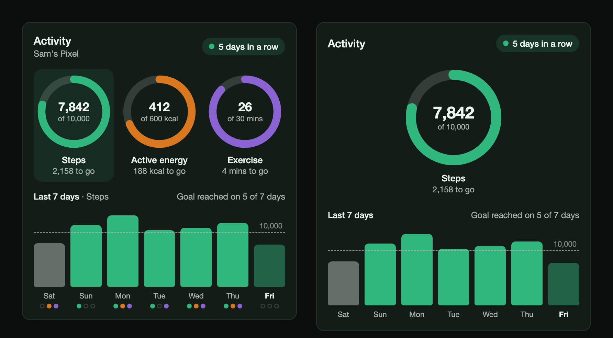
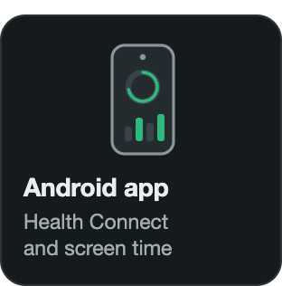
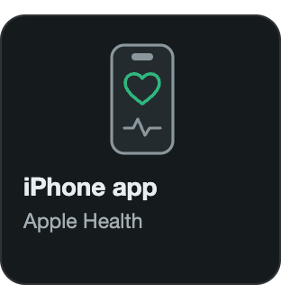
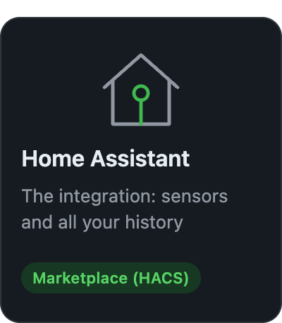
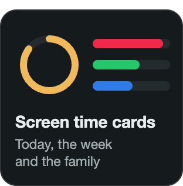
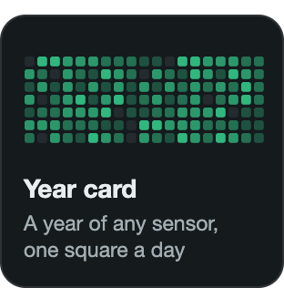
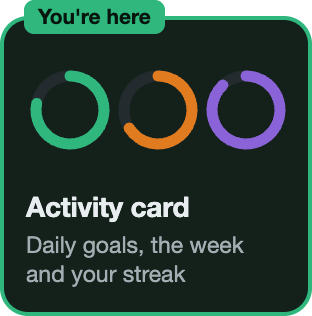
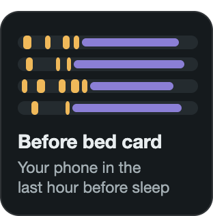

<p align="center">
  
</p>

<h1 align="center">Life Dashboard Activity Card</h1>

<p align="center">
  <b>Your daily activity goals on your Home Assistant dashboard.</b><br>
  Steps, active energy and exercise as rings, the last seven days against the goal, and how many days in a row you made it.
</p>

<p align="center">
  <a href="https://my.home-assistant.io/redirect/hacs_repository/?owner=owen282000&repository=life-dashboard-activity-card&category=plugin"></a>
  <a href="https://github.com/owen282000/life-dashboard-activity-card/releases/latest"></a>
  <a href="https://www.home-assistant.io/"></a>
  <a href="https://github.com/owen282000/life-dashboard-activity-card/blob/main/LICENSE"></a>
</p>

<p align="center">
  <a href="https://github.com/owen282000/life-dashboard-activity-card#install"><b>Install</b></a>
  &nbsp;·&nbsp;
  <a href="https://github.com/owen282000/life-dashboard-activity-card#configure">Configure</a>
  &nbsp;·&nbsp;
  <a href="https://github.com/owen282000/life-dashboard-activity-card#works-with-any-sensor">Any&nbsp;sensor</a>
  &nbsp;·&nbsp;
  <a href="https://owen282000.com/life-dashboard/">Website</a>
</p>

<!-- life-dashboard:nav -->
<p align="center">
  <sub>Life Dashboard: <a href="https://github.com/owen282000/life-dashboard-companion-app">Android app</a> &nbsp;·&nbsp; <a href="https://github.com/owen282000/life-dashboard-companion-app-ios">iPhone app</a> &nbsp;·&nbsp; <a href="https://github.com/owen282000/life-dashboard-ha">Home Assistant integration</a> &nbsp;·&nbsp; <a href="https://github.com/owen282000/life-dashboard-stack">Grafana stack</a> &nbsp;·&nbsp; <a href="https://github.com/owen282000/life-dashboard-sleep-card">Sleep card</a> &nbsp;·&nbsp; <a href="https://github.com/owen282000/life-dashboard-screen-time-card">Screen time cards</a> &nbsp;·&nbsp; <a href="https://github.com/owen282000/life-dashboard-year-card">Year card</a> &nbsp;·&nbsp; <b>Activity card</b> &nbsp;·&nbsp; <a href="https://github.com/owen282000/life-dashboard-before-bed-card">Before bed card</a></sub>
</p>
<!-- /life-dashboard:nav -->

<p align="center">
  <picture>
    <source media="(max-width: 600px) and (prefers-color-scheme: light)" srcset="https://raw.githubusercontent.com/owen282000/life-dashboard-activity-card/main/docs/readme-hero-phone-light.png">
    <source media="(max-width: 600px)" srcset="https://raw.githubusercontent.com/owen282000/life-dashboard-activity-card/main/docs/readme-hero-phone.png">
    <source media="(prefers-color-scheme: light)" srcset="https://raw.githubusercontent.com/owen282000/life-dashboard-activity-card/main/docs/readme-hero-light.png">
    
  </picture>
  <br><sub>Sample data from a made-up phone. Three sensors: 7,842 of 10,000 steps, 412 of 600 kcal and 26 of 30 minutes, each with what is left to go, and a dot per goal under each day. On a wide screen the card with one steps sensor is next to it</sub>
</p>

The card reads up to three sensors and draws today against a goal for each. The earlier days and the streak come from the long-term statistics Home Assistant already keeps.

With the [Life Dashboard app](https://github.com/owen282000/life-dashboard-companion-app) on your phone the card fills itself: all three rings from whatever watch or app counted them, and a full week and streak on the first day instead of a chart that starts today.

<a href="https://play.google.com/store/apps/details?id=com.owen282000.lifedashboard&referrer=utm_source%3Dgh-activity-readme%26utm_medium%3Dreadme"></a> <a href="https://apps.apple.com/app/apple-store/id6824075761?pt=128699800&ct=gh-activity-readme&mt=8"></a>

The card also works without the app, with any steps sensor you have, from Fitbit, Garmin, Withings or Home Assistant's Companion app. See [Works with any sensor](https://github.com/owen282000/life-dashboard-activity-card#works-with-any-sensor).

## What you get

- **Today as rings.** One, two or three of them: steps, active energy and exercise. Each shows the number, the goal, and how much is left or that the goal is reached.
- **The last seven days.** A bar per day against the goal as a dashed line, and how many of the seven days were on goal. Tap a ring to put its goal in the chart. With more than one ring, a dot per goal under each day shows which ones you reached.
- **Days in a row.** The streak of the goal in the chart, or of the days on which you reached every goal. A day that is still running does not break it: today counts once you get there.
- **Goals you can change.** A number in the card, or an `input_number` helper, so a button, an automation or a slider on your dashboard can move the goal.
- **Every day on demand.** Hover or tap a bar for its date and value. On a keyboard, focus the chart and use the arrow keys, Home and End. Screen readers get a table of the week.
- **Your locale and theme.** English, Arabic, Chinese, Dutch, French, German, Hindi, Italian, Japanese, Portuguese and Spanish, numbers in your language, and your theme's colors in light and dark.

## Install

### Through the Home Assistant Marketplace

In **Settings > Marketplace** (HACS before Home Assistant 2026.11), search for **Life Dashboard Activity Card** and download it. The button opens it in your Home Assistant straight away:

[](https://my.home-assistant.io/redirect/hacs_repository/?owner=owen282000&repository=life-dashboard-activity-card&category=plugin)

If the search finds nothing, your Home Assistant has not refreshed its list yet. Until it does, add the repository yourself: the three dots, **Custom repositories**, and `https://github.com/owen282000/life-dashboard-activity-card` as the type **Dashboard**.

On storage mode dashboards the resource is registered for you. If your dashboards are in YAML mode, add it yourself:

```yaml
lovelace:
  resources:
    - url: /hacsfiles/life-dashboard-activity-card/life-dashboard-activity-card.js
      type: module
```

### By hand

Copy `dist/life-dashboard-activity-card.js` into the `www` folder of your Home Assistant configuration and add it as a resource of the type JavaScript module with the URL `/local/life-dashboard-activity-card.js`.

### Is it working?

After downloading, refresh the browser, or you get "Custom element doesn't exist: life-dashboard-activity-card". You should now see **Life Dashboard Activity** in the card picker.

The picker fills in the sensors it finds by the end of their entity id: `_steps_today`, `_daily_steps` or `_steps` for steps, `_active_calories_today`, `_active_calories`, `_active_energy` or `_active_energy_burned` for active energy, and `_exercise_today`, `_exercise_minutes`, `_exercise_time` or `_active_minutes` for exercise. If a ring stays empty, that sensor does not exist yet or has another name, and you can pick it yourself in the editor. With the Life Dashboard app the sensors appear after the phone's first sync, and **Exercise today** only once the phone has sent a workout.

## Configure

The card is in the card picker as **Life Dashboard Activity**, with a visual editor. Or in YAML, with one sensor:

```yaml
type: custom:life-dashboard-activity-card
steps: sensor.your_watch_steps
steps_goal: 10000
```

With all three, and a goal that comes from a helper:

```yaml
type: custom:life-dashboard-activity-card
steps: sensor.your_phone_steps_today
steps_goal: input_number.step_goal
energy: sensor.your_phone_active_calories_today
energy_goal: 600
exercise: sensor.your_phone_exercise_today
exercise_goal: 30
streak: all
```

| Option | Description |
| --- | --- |
| `steps` | A sensor with today's steps |
| `energy` | A sensor with today's active energy, in kcal or kJ |
| `exercise` | A sensor with today's exercise or active time, in minutes or hours |
| `steps_goal`, `energy_goal`, `exercise_goal` | The daily goal: a number, or the entity id of an `input_number`, a `number` or a sensor. Without one: 10,000 steps, 500 kcal and 30 minutes |
| `streak` | `all` counts the days on which every goal was reached. Left out, the streak is of the goal in the chart |
| `title` | Instead of "Activity" |

Give the card one, two or three of the sensors, in any combination. Every ring you leave out is simply not drawn.

## Works with any sensor

Nothing here needs the Life Dashboard app. Each ring wants a sensor whose state is today's total and starts at zero each day, which is what most integrations for watches and phones give you for steps.

- **Today** is the sensor's state. Energy in kJ and exercise in hours are converted.
- **The earlier days and the streak** come from the sensor's long-term statistics, so the sensor needs a state class (`total_increasing`, `total` or `measurement`). You can check in a statistics graph card: if the sensor is offered there, this card can read it.
- **A new sensor** has no statistics for the days before you added it. The chart then starts today, the card says so, and the week fills up day by day.
- **Active energy and exercise** work the same way when you have a sensor for them. Many sources only give steps, and then the card is one larger ring with the week under it.

The streak uses today's goal for every earlier day, so changing a goal changes the streak too. It looks back a year at most.

## Gets more with the Life Dashboard app

The [Life Dashboard app](https://github.com/owen282000/life-dashboard-companion-app) sends what Health Connect on Android or Apple Health on an iPhone has to its [Home Assistant integration](https://github.com/owen282000/life-dashboard-ha), whatever watch or app counted it. Pick the phone's **Steps today**, **Active calories today** and **Exercise today** sensors, and the card picker fills them in for you when it finds them.

- **All three rings.** Active energy and exercise minutes come along from Health Connect and Apple Health, so you need no separate sensor for them.
- **A week on the first day.** The integration keeps a total per day as its own long-term statistics, and **Send history** in the app sends the days from before you installed it. The chart and the streak are filled in from the start instead of beginning today.

The app is free and open source: for Android as an APK on GitHub and on F-Droid, and the iPhone app can be built yourself. If you would rather have updates handled for you, it is listed on Google Play and the App Store as Health Data for Home Assistant: [Google Play](https://play.google.com/store/apps/details?id=com.owen282000.lifedashboard&referrer=utm_source%3Dgh-activity-readme%26utm_medium%3Dreadme) for the [Android app](https://github.com/owen282000/life-dashboard-companion-app) at €4.99 (US$4.99) once, and the [App Store](https://apps.apple.com/app/apple-store/id6824075761?pt=128699800&ct=gh-activity-readme&mt=8) for the [iPhone app](https://github.com/owen282000/life-dashboard-companion-app-ios) at €6.99 (US$5.99) once.

## Colors

| Variable | Default |
| --- | --- |
| `--life-dashboard-activity-steps` | the theme's `--primary-color` |
| `--life-dashboard-activity-energy` | `#d9781f` |
| `--life-dashboard-activity-exercise` | `#8a63d2` |

## Part of Life Dashboard

This card sits on top of Life Dashboard's other parts, and you only install the ones you need. More at [owen282000.com/life-dashboard](https://owen282000.com/life-dashboard/).

<p align="center">
  <b>Start here: the app on your phone</b><br>
  <a href="https://github.com/owen282000/life-dashboard-companion-app"><picture><source media="(prefers-color-scheme: light)" srcset="https://raw.githubusercontent.com/owen282000/life-dashboard-activity-card/main/docs/family/android-light.png"></picture></a>
  <a href="https://github.com/owen282000/life-dashboard-companion-app-ios"><picture><source media="(prefers-color-scheme: light)" srcset="https://raw.githubusercontent.com/owen282000/life-dashboard-activity-card/main/docs/family/ios-light.png"></picture></a>
</p>

<p align="center">
  <picture><source media="(prefers-color-scheme: light)" srcset="https://raw.githubusercontent.com/owen282000/life-dashboard-activity-card/main/docs/family/arrow-light.png"></picture><br>
  <sub>sends your data to</sub>
</p>

<p align="center">
  <b>Where the data goes</b><br>
  <a href="https://github.com/owen282000/life-dashboard-stack"><picture><source media="(prefers-color-scheme: light)" srcset="https://raw.githubusercontent.com/owen282000/life-dashboard-activity-card/main/docs/family/stack-light.png"></picture></a>
  <a href="https://github.com/owen282000/life-dashboard-ha"><picture><source media="(prefers-color-scheme: light)" srcset="https://raw.githubusercontent.com/owen282000/life-dashboard-activity-card/main/docs/family/ha-light.png"></picture></a>
  <a href="https://owen282000.com/life-dashboard/health-connect-webhook/"><picture><source media="(prefers-color-scheme: light)" srcset="https://raw.githubusercontent.com/owen282000/life-dashboard-activity-card/main/docs/family/own-server-light.png"></picture></a>
</p>

<p align="center">
  <picture><source media="(prefers-color-scheme: light)" srcset="https://raw.githubusercontent.com/owen282000/life-dashboard-activity-card/main/docs/family/arrow-light.png"></picture>
</p>

<p align="center">
  <b>Cards for your Home Assistant dashboard</b><br>
  <sub>They need Home Assistant; most work with any sensor, and the integration fills them with your history.</sub><br>
  <a href="https://github.com/owen282000/life-dashboard-sleep-card"><picture><source media="(prefers-color-scheme: light)" srcset="https://raw.githubusercontent.com/owen282000/life-dashboard-activity-card/main/docs/family/sleep-card-light.png"></picture></a>
  <a href="https://github.com/owen282000/life-dashboard-screen-time-card"><picture><source media="(prefers-color-scheme: light)" srcset="https://raw.githubusercontent.com/owen282000/life-dashboard-activity-card/main/docs/family/screen-time-card-light.png"></picture></a>
  <a href="https://github.com/owen282000/life-dashboard-year-card"><picture><source media="(prefers-color-scheme: light)" srcset="https://raw.githubusercontent.com/owen282000/life-dashboard-activity-card/main/docs/family/year-card-light.png"></picture></a>
  <picture><source media="(prefers-color-scheme: light)" srcset="https://raw.githubusercontent.com/owen282000/life-dashboard-activity-card/main/docs/family/activity-card-here-light.png"></picture>
  <a href="https://github.com/owen282000/life-dashboard-before-bed-card"><picture><source media="(prefers-color-scheme: light)" srcset="https://raw.githubusercontent.com/owen282000/life-dashboard-activity-card/main/docs/family/before-bed-card-light.png"></picture></a>
</p>

## Privacy

The card only reads what Home Assistant already gives your browser: the sensors' state and, for the earlier days, the recorder's statistics. It makes no requests of its own, has no telemetry or analytics, and there's no server of mine in the path.

<!-- life-dashboard:built -->
## How this is built

Life Dashboard is a one-person project, and [Claude Code](https://claude.com/claude-code) writes a large part of the code. I decide what gets built, read every change before it is merged, and test it on my own phones and Home Assistant before a release. Automated checks run on every pull request, and the [AI policy](https://github.com/owen282000/life-dashboard-companion-app/blob/main/AI_POLICY.md) explains what the AI does and what I check.
<!-- /life-dashboard:built -->

## Documentation

- [Changelog](https://github.com/owen282000/life-dashboard-activity-card/blob/main/CHANGELOG.md)
- [The Health dashboard](https://github.com/owen282000/life-dashboard-ha/blob/main/docs/dashboard.md) of the integration, to put this card on

## Help and contributing

Bugs go to [issues](https://github.com/owen282000/life-dashboard-activity-card/issues) here. Questions go to the integration's [Discussions](https://github.com/owen282000/life-dashboard-ha/discussions). No GitHub account? Use the [feedback board](https://owen282000.com/life-dashboard/feedback/), which needs no account. Everything on it is public, so leave out health data, logs and webhook URLs.

Pull requests are welcome, see [CONTRIBUTING](https://github.com/owen282000/life-dashboard-activity-card/blob/main/CONTRIBUTING.md). The card is one JavaScript file with no dependencies and no build step. Security problems go through a [private advisory](https://github.com/owen282000/life-dashboard-activity-card/security/advisories/new).

## Support the project

Stars, shares and good bug reports all help. If you want to chip in for the evenings that go into it, there's [Ko-fi](https://ko-fi.com/owen282000). The card stays free and open source (MIT) either way.

MIT licensed. See [LICENSE](https://github.com/owen282000/life-dashboard-activity-card/blob/main/LICENSE).

<!-- life-dashboard:footer -->
<p align="center">
  <sub>Made by <a href="https://github.com/owen282000">Owen Vogelaar</a> for the self-hosting and quantified self crowd.</sub><br>
  <sub>Google Play and the Google Play logo are trademarks of Google LLC.</sub><br>
  <sub>Apple, the Apple logo and App Store are trademarks of Apple Inc.</sub>
</p>
<!-- /life-dashboard:footer -->
